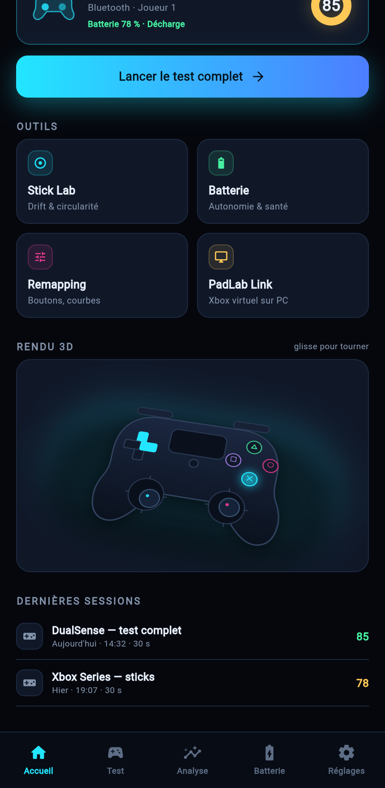
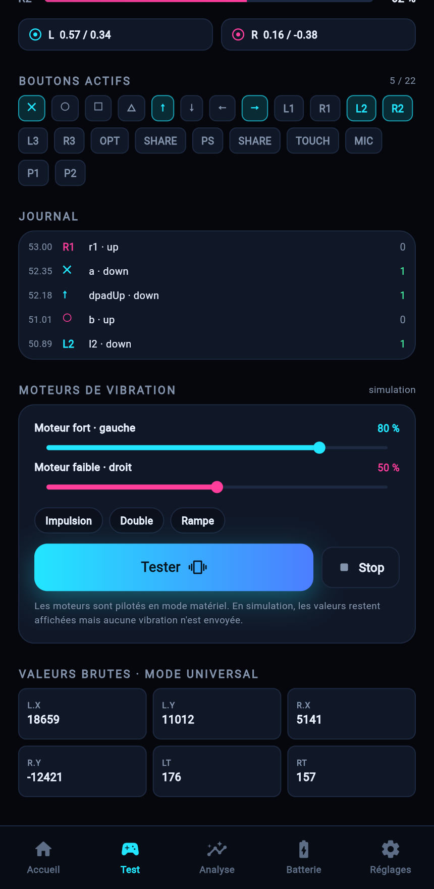
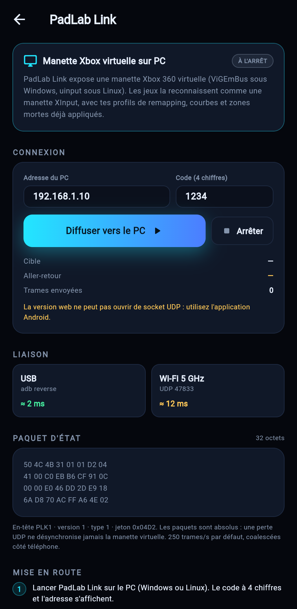
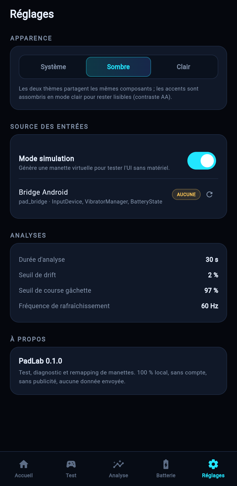
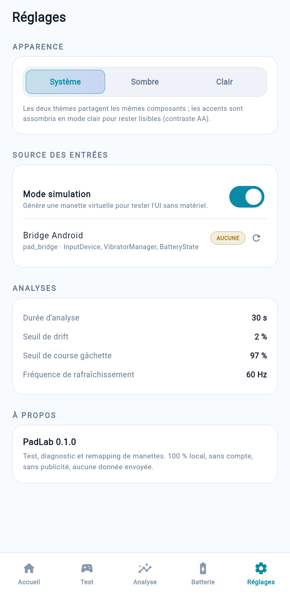

# PadLab

[](https://github.com/NiceMank/GamePad-Test/actions/workflows/ci.yml)

**Test, diagnostic et remapping de manettes** — application Flutter, Android d'abord,
plus un relais PC qui émule une **manette Xbox 360** pour jouer avec n'importe quelle
manette connectée au téléphone.

```
apps/mobile       Application Android (et build web de démonstration)
apps/pclink       PadLab Link : réception UDP + manette virtuelle Xbox (Windows/Linux)
packages/pad_core Domain : modèle, analyseurs, remapping, protocole réseau
packages/pad_ui   Design system : thème néon/clair, manette 2D et 3D, composants
packages/pad_bridge Plugin Android : InputDevice, MotionEvent 1000 Hz, batterie, vibration
```

## Ce que fait l'application

| Écran | Contenu |
|---|---|
| Accueil | manette 3D temps réel, score de santé, raccourcis, batterie |
| Test | 5 dispositions (Android, PS, Xbox, Switch, universelle), gâchettes analogiques, glyphes, journal, valeurs brutes, **test des deux moteurs de vibration** (impulsion / double / rampe) |
| Analyse | dérive, deadzone, circularité, linéarité des gâchettes, fréquence et jitter de polling, traînée du stick |
| Batterie | pourcentage, statut de charge, autonomie estimée avec niveau de confiance, santé A–E, historique |
| Remapping | bouton→bouton, axe→bouton, stick→croix, deadzones, courbes, inversion, profils JSON |
| Link | protocole binaire `PLK1`, appairage, transports USB/Wi-Fi, envoi vers le PC |
| Réglages | thème système/sombre/clair, source des entrées (simulation ↔ matériel), détection des manettes |

Le mode **simulation** permet d'utiliser toute l'application sans manette (et sur le web) ;
le mode **matériel** lit la manette via le plugin natif.

## Aperçus

| Accueil (sombre) | Test — moteurs | PadLab Link |
|---|---|---|
|  |  |  |

| Réglages sombre | Réglages clair |
|---|---|
|  |  |

## PadLab Link (PC)

`apps/pclink` écoute en UDP `47833` (secours TCP `47834`), vérifie le code à 4 chiffres,
puis pousse chaque état vers une manette virtuelle :

* **Windows** : ViGEmBus → Xbox 360 (XInput). Compatibilité maximale, aucun pilote maison.
* **Linux** : `/dev/uinput` → périphérique evdev `045E:028E`, reconnu par SDL/Proton/Steam.

Les paquets d'état sont **absolus** (32 octets, ~250–1000 Hz) : une perte UDP ne
désynchronise jamais la manette virtuelle. Côté PC, l'écriture se fait dans la même
boucle que la réception, sans allocation, pour ne pas ajouter de latence.

### Prérequis

* Windows : installer [ViGEmBus](https://github.com/nefarius/ViGEmBus/releases) (pilote signé).
* Linux : `sudo modprobe uinput` et appartenance au groupe `input` (ou `uinput`), sinon le
  backend retombe proprement en mode simulation.

## Télécharger

Onglet **Actions → Build PadLab → dernier run vert → Artifacts** :

| Artefact | Contenu |
|---|---|
| `padlab-android` | `app-release.apk` (49 Mo, arm64 + armv7 + x86_64) et `app-release.aab` |
| `padlab-link-windows` | `pclink.exe` + DLL Flutter |
| `padlab-link-linux` | binaire `pclink` + `lib/` + `data/` |
| `padlab-web` | build web complet (démo sans installation) |

L'APK est signé avec la clé **debug** : parfait pour installer et tester,
à remplacer par une clé de release avant publication sur le Play Store.

## Build

Tout est construit par GitHub Actions (`.github/workflows/ci.yml`) : analyse, tests,
APK + AAB Android, web, binaires Windows et Linux, téléchargeables depuis l'onglet
**Actions → Build PadLab → Artifacts**.

En local :

```bash
flutter pub get
(cd packages/pad_core && flutter test)
(cd apps/mobile && flutter build apk --release)
(cd apps/pclink && flutter build windows --release)   # ou --linux
```
