# PadLab

[](https://github.com/NiceMank/GamePad-Test/actions/workflows/ci.yml)

**Test, diagnostic et remapping de manettes** — application Flutter, Android d'abord,
plus un relais PC qui émule une **manette Xbox 360** pour jouer avec n'importe quelle
manette connectée au téléphone.

> **0.5.0** — introduction au premier lancement, logo PadLab (icône + écran de
> lancement) et actualisation automatique des manettes et de la batterie.
> Voir [`docs/CHANGELOG.md`](docs/CHANGELOG.md).

| Icône | Écran de lancement |
|---|---|
|  | 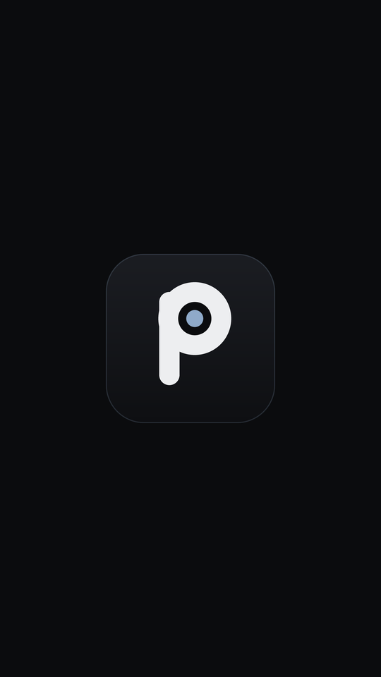 |

L'introduction du premier lancement explique en quatre écrans ce que fait
l'application — dont le fait que les entrées lues sont réelles, et ce qui
n'est volontairement pas inventé.

| Étape 1 | Étape 3 | Étape 4 |
|---|---|---|
| 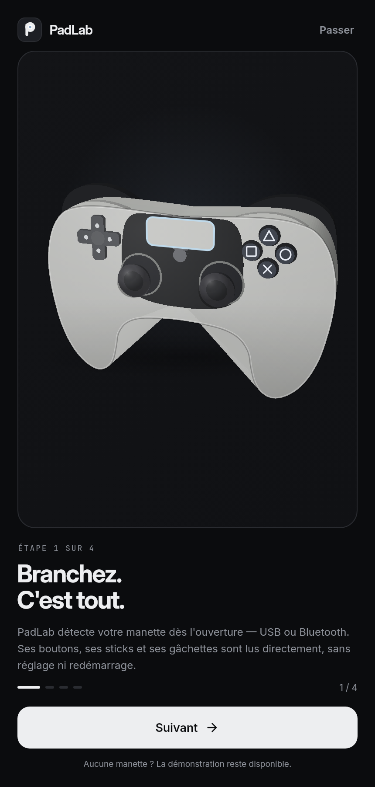 | 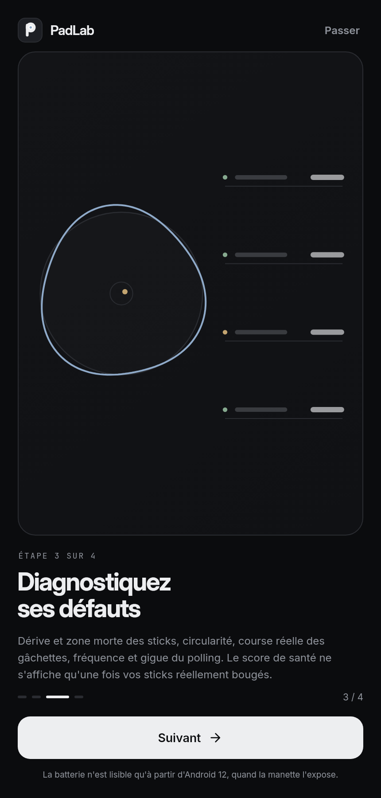 | 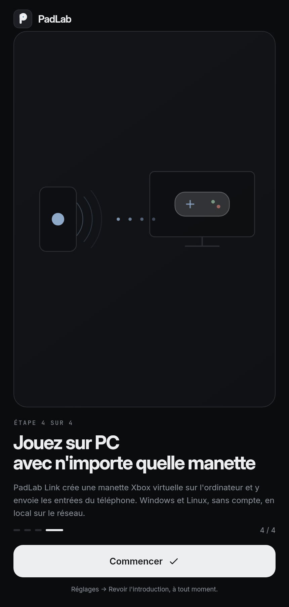 |

```
apps/mobile       Application Android (et build web de démonstration)
apps/pclink       PadLab Link : réception UDP + manette virtuelle Xbox (Windows/Linux)
packages/pad_core Domain : modèle, analyseurs, remapping, protocole réseau
packages/pad_ui   Design system : thème néon/clair, manette 2D et 3D, composants
packages/pad_bridge Plugin Android : InputDevice, MotionEvent 1000 Hz, batterie, vibration
```

## Ce que fait l'application

| Écran | Contenu |
|---|---|
| Accueil | manette 3D temps réel, score de santé, raccourcis, batterie |
| Test | 5 dispositions (Android, PS, Xbox, Switch, universelle), gâchettes analogiques, glyphes, journal, valeurs brutes, **test des deux moteurs de vibration** (impulsion / double / rampe) |
| Analyse | dérive, deadzone, circularité, linéarité des gâchettes, fréquence et jitter de polling, traînée du stick |
| Batterie | pourcentage, statut de charge, autonomie estimée avec niveau de confiance, santé A–E, historique |
| Remapping | bouton→bouton, axe→bouton, stick→croix, deadzones, courbes, inversion, profils JSON |
| Link | protocole binaire `PLK1`, appairage, transports USB/Wi-Fi, envoi vers le PC |
| Réglages | thème système/sombre/clair, source des entrées (Auto / Manette / Démo), détection des manettes |

### Vraie manette ou démonstration ?

Au démarrage, PadLab cherche une manette. **Si elle est là, ses entrées sont lues
directement** : boutons, sticks, gâchettes, batterie, vibration. Aucune manipulation
n'est nécessaire, et le badge de l'accueil affiche `Réel` en vert.

Sans manette, l'accueil l'annonce (« Aucune manette branchée ») et propose la
démonstration, clairement étiquetée `Démo`. Brancher une manette à chaud bascule
tout seul en réel ; la débrancher ramène à la démonstration avec le motif affiché.

Trois modes sont disponibles dans Réglages : **Auto** (recommandé), **Manette**
(uniquement le matériel, l'écran reste vide s'il n'y en a pas) et **Démo**.
Les mesures de démonstration ne sont jamais mélangées à des mesures réelles :
changer de source remet les analyseurs à zéro.

### Ce qui est lu, et ce qui ne l'est pas

| Donnée | Source |
|---|---|
| Boutons, croix directionnelle | `KeyEvent` → `KEYCODE_BUTTON_*` |
| Sticks, gâchettes | `MotionEvent` → `AXIS_*` (histogramme natif inclus) |
| Nom, VID/PID, transport | `InputDevice` |
| Batterie | `InputDevice.getBatteryState()` — **Android 12+** |
| Vibration | `VibratorManager`, deux canaux quand la manette les expose |

Honnêteté sur les limites : sous Android 12, l'API batterie n'existe pas et
l'écran affiche « non exposée » plutôt qu'un pourcentage inventé. Le remapping
système Android resterait impossible sans root ; PadLab remappe dans
l'application et, côté PC, via une manette Xbox virtuelle. iOS n'est pas couvert.

## Aperçus

Refonte de l'interface et manette 3D reconstruite pièce par pièce (rotation 360°,
modèle propre à chaque famille, allumage des touches identique à un appui réel).

| Accueil, manette réelle | Accueil, aucune manette |
|---|---|
| 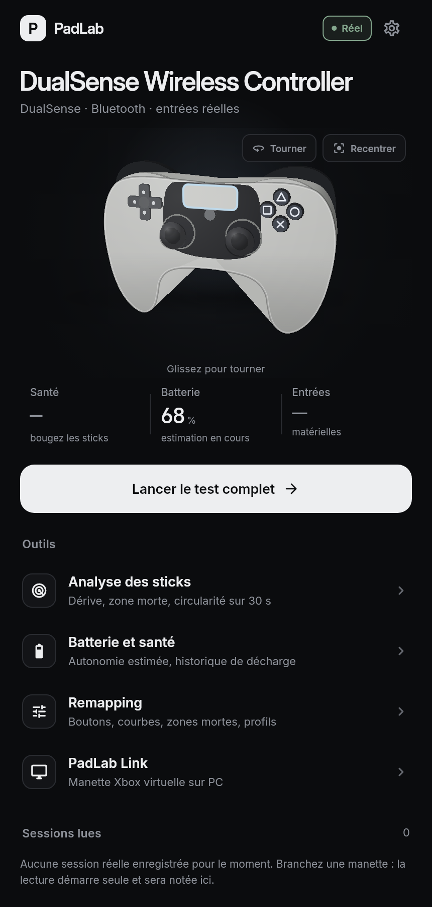 | 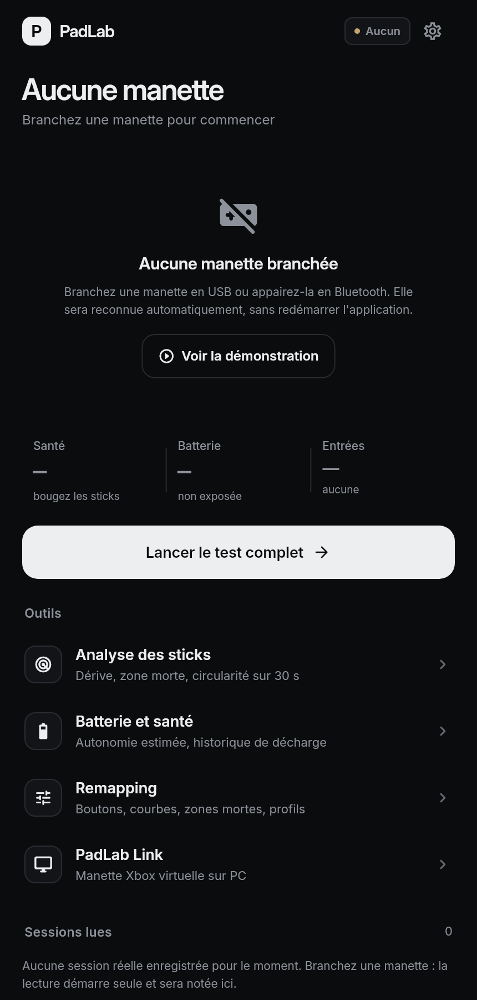 |

| Rotation complète (DualSense) |
|---|
| 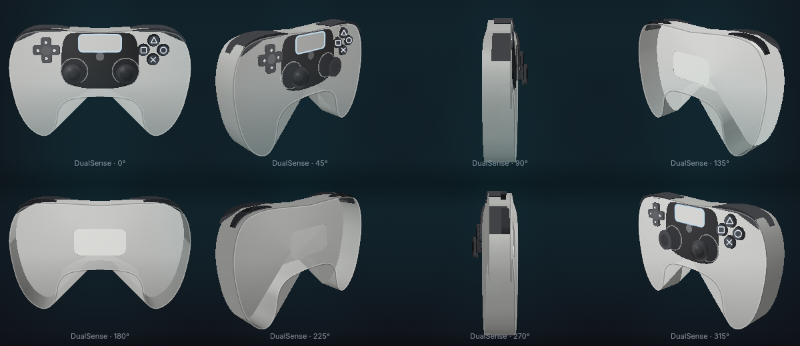 |

| Un modèle par famille |
|---|
| 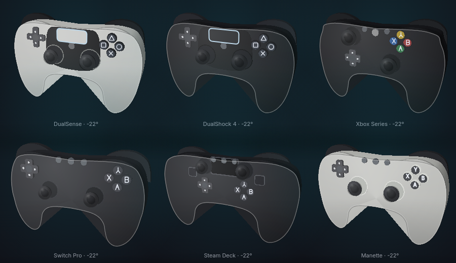 |

| Accueil | Test d'entrées | Analyse |
|---|---|---|
| 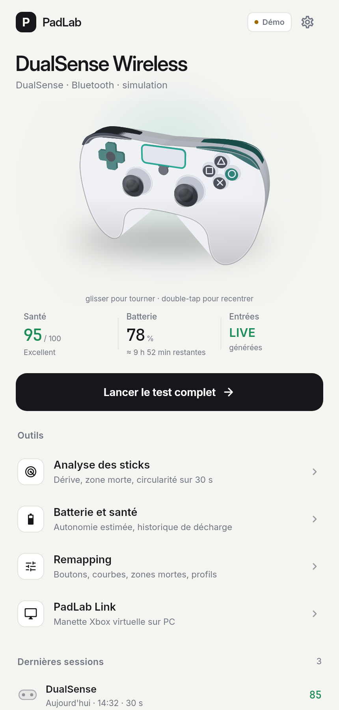 | 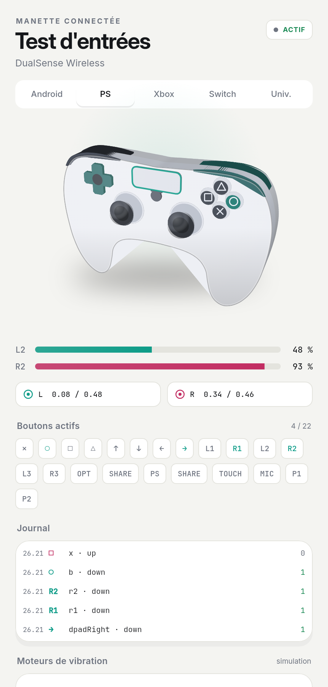 | 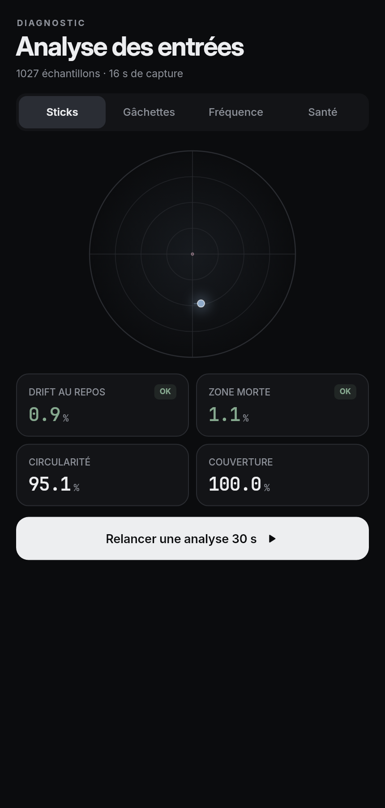 |

| Batterie | Remapping | PadLab Link |
|---|---|---|
| 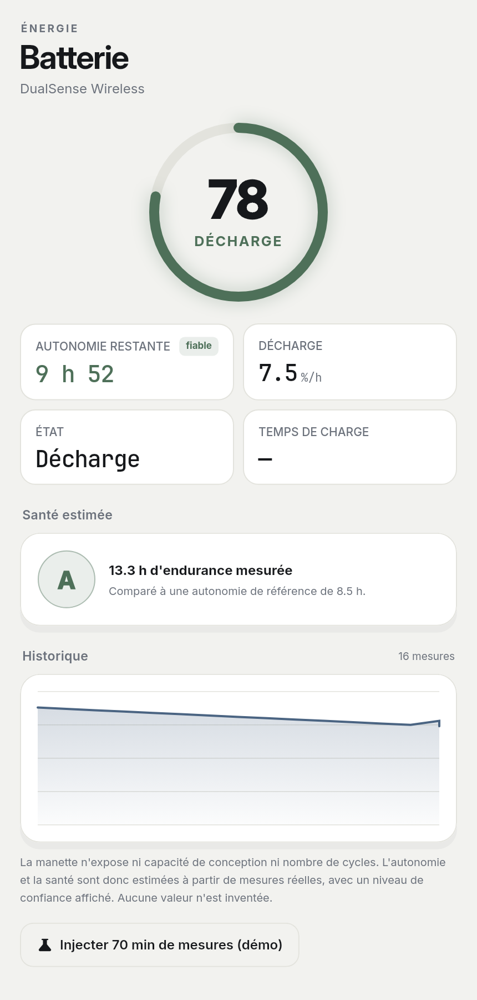 | 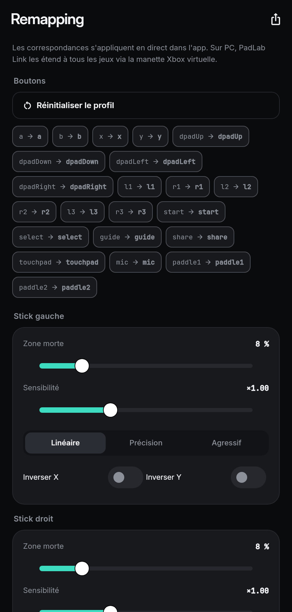 | 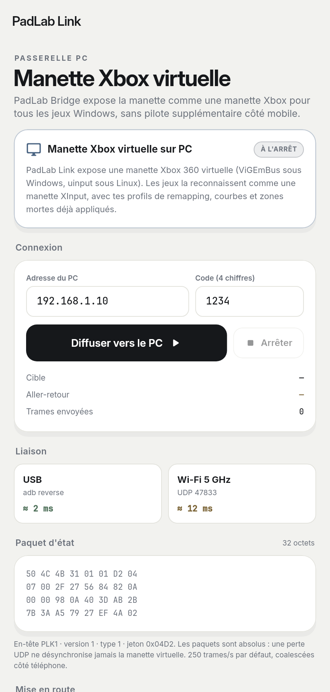 |

Les rendus sont produits par les tests (`packages/pad_ui/test/preview_strip_test.dart`
et `apps/mobile/test/screens_golden_test.dart`) : pas de capture à l'œil, donc pas
d'illustration qui vieillit sans qu'on le voie.

Un appui sur une touche du modèle 3D passe par le même chemin qu'un appui
matériel (remap → état → journal → analyseurs) et se relâche seul. Un test le
vérifie : `apps/mobile/test/tap_to_state_test.dart`.

## PadLab Link (PC)

**La version PC est `apps/pclink`** — application Flutter desktop (Windows et Linux).
Binaires prêts à l'emploi : [`docs/PC.md`](docs/PC.md) et la
[release v0.4.0](https://github.com/NiceMank/GamePad-Test/releases/tag/v0.4.0)
(`PadLab-Link-0.4.0-windows-x64.zip`, `PadLab-Link-0.4.0-linux-x64.tar.gz`).
La CI compile aussi `ViGEmClient.dll` et le livre à côté de l'exécutable.

`apps/pclink` écoute en UDP `47833` (secours TCP `47834`), vérifie le code à 4 chiffres,
puis pousse chaque état vers une manette virtuelle :

* **Windows** : ViGEmBus → Xbox 360 (XInput). Compatibilité maximale, aucun pilote maison.
* **Linux** : `/dev/uinput` → périphérique evdev `045E:028E`, reconnu par SDL/Proton/Steam.

Les paquets d'état sont **absolus** (32 octets, ~250–1000 Hz) : une perte UDP ne
désynchronise jamais la manette virtuelle. Côté PC, l'écriture se fait dans la même
boucle que la réception, sans allocation, pour ne pas ajouter de latence.

### Prérequis

* Windows : installer [ViGEmBus](https://github.com/nefarius/ViGEmBus/releases) (pilote signé).
* Linux : `sudo modprobe uinput` et appartenance au groupe `input` (ou `uinput`), sinon le
  backend retombe proprement en mode simulation.

## Télécharger

Onglet **Actions → Build PadLab → dernier run vert → Artifacts** :

| Artefact | Contenu |
|---|---|
| `padlab-android` | `app-release.apk` (49 Mo, arm64 + armv7 + x86_64) et `app-release.aab` |
| `padlab-link-windows` | `pclink.exe` + DLL Flutter |
| `padlab-link-linux` | binaire `pclink` + `lib/` + `data/` |
| `padlab-web` | build web complet (démo sans installation) |

L'APK est signé avec la clé **debug** : parfait pour installer et tester,
à remplacer par une clé de release avant publication sur le Play Store.

## Build

Tout est construit par GitHub Actions (`.github/workflows/ci.yml`) : analyse, tests,
APK + AAB Android, web, binaires Windows et Linux, téléchargeables depuis l'onglet
**Actions → Build PadLab → Artifacts**.

En local :

```bash
flutter pub get
(cd packages/pad_core && flutter test)
(cd apps/mobile && flutter build apk --release)
(cd apps/pclink && flutter build windows --release)   # ou --linux
```
